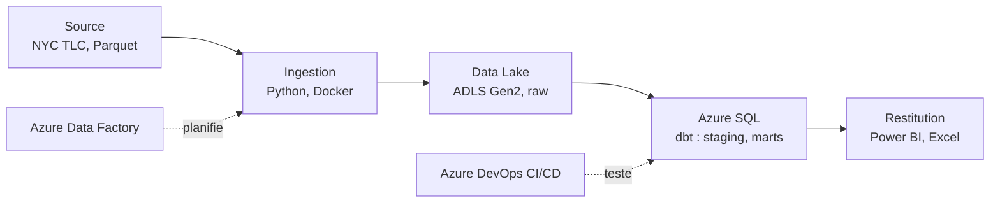

# NYC Taxi Azure Pipeline

Pipeline data de bout en bout sur Azure : de 24 mois de courses de taxis new-yorkais jusqu'à un dashboard Power BI, avec contrôle qualité, orchestration et cadrage produit.

**Statut : en construction.** L'avancement station par station est en bas de page.

## Le besoin métier

Une société de taxis fictive veut piloter son activité par la donnée. Elle cherche à savoir où et quand ses courses rapportent le plus, ce que représentent les pourboires, combien de temps durent les trajets, et dans quelle mesure les chiffres sont fiables.

## Indicateurs

| Indicateur | Question métier |
| --- | --- |
| Revenu par zone et par heure | Où et quand positionner les véhicules ? |
| Courses par heure | Quand la demande est-elle la plus forte ? |
| Taux de pourboire | Que rapportent réellement les courses ? |
| Durée moyenne des courses | Combien de temps dure un trajet ? |
| Part de courses anormales | Les données sont-elles fiables ? |

## Données

- Source : [NYC TLC Trip Records](https://www.nyc.gov/site/tlc/about/tlc-trip-record-data.page), taxis jaunes
- Période : janvier 2023 à décembre 2024, soit 24 fichiers Parquet
- Volume : environ 80 millions de lignes (estimation)
- Défauts attendus : dates aberrantes, montants négatifs, zones inconnues. Ils servent à démontrer de vrais contrôles qualité.

## Architecture



Schéma en noir et blanc : `docs/architecture.png` (à venir).

## Choix techniques

| Outil | Rôle | Alternative écartée |
| --- | --- | --- |
| Azure Data Lake Storage Gen2 | Stocker les fichiers bruts | Une base de données seule |
| Azure SQL Database | Entrepôt de données | Synapse, Databricks (plus coûteux, sans gain ici) |
| dbt | Transformer en SQL, avec des tests | Scripts SQL lancés à la main |
| Azure Data Factory | Planifier le pipeline chaque mois | Airflow à héberger |
| pandas et DuckDB | Explorer un échantillon, puis traiter le volume complet | PySpark, plus lourd à mettre en place |
| Power BI | Dashboard sur le modèle en étoile | Excel seul |
| Azure DevOps Pipelines | CI/CD | GitHub Actions |

## Modèle de données

Schéma en étoile dont le grain est une course : une table de faits `fait_courses` et les dimensions `dim_zone`, `dim_date`, `dim_paiement` et `dim_tarif`. Les données traversent quatre couches : `raw`, `staging`, `intermediate` si nécessaire, puis `marts`.

## Structure du dépôt

```text
nyc-taxi-azure-pipeline/
├── ingestion/          # téléchargement, validation, dépôt dans le lac
├── warehouse/          # scripts SQL Azure, chargement de la couche raw
├── dbt/                # staging, intermediate, marts, tests
├── analysis/           # notebooks pandas et DuckDB (profilage, anomalies)
├── reporting/          # fichier Power BI, rapport Excel
├── infra/              # description des ressources Azure (Bicep, optionnel)
├── .azure-pipelines/   # CI/CD
├── docs/               # architecture, dictionnaire de données, règles de gestion, backlog, recette
└── README.md
```

## Démarrage rapide

```bash
git clone https://github.com/NaelleNangmo/nyc-taxi-azure-pipeline.git
cd nyc-taxi-azure-pipeline
python -m venv .venv
source .venv/bin/activate    # Windows : .venv\Scripts\activate
pip install -r requirements.txt
```

Les étapes d'ingestion, de chargement et de transformation seront documentées ici au fil de l'avancement.

Aucun secret n'est versionné. Les chaînes de connexion Azure se placent dans des variables d'environnement ou dans un fichier `.env`, ignoré par Git.

## Qualité des données

Chaque règle de gestion est écrite dans `docs/regles_gestion.md`, puis devient un test dbt. Les lignes rejetées sont comptées et le taux de courses anormales est affiché dans le dashboard.

## Coûts Azure

Une alerte de budget est créée avant toute ressource. Toutes les ressources vivent dans un seul groupe, `rg-nyc-taxi`, supprimé entre deux sessions de travail.

## Avancement

- [ ] 0. Poser le cadre
- [ ] 1. Explorer un mois de données
- [ ] 2. Écrire les règles de gestion
- [ ] 3. Dessiner le modèle en étoile
- [ ] 4. Préparer Azure
- [ ] 5. Automatiser l'ingestion
- [ ] 6. Charger et transformer avec dbt
- [ ] 7. Planifier et industrialiser
- [ ] 8. Restituer avec Power BI et Excel
- [ ] 9. Cadrer comme Data Product Owner

## Ce que ce projet démontre

- Ingestion automatisée et idempotente vers un data lake
- Modélisation en étoile et transformations ELT testées avec dbt
- Contrôle de la qualité des données à partir de règles de gestion
- Orchestration et CI/CD sur Azure
- Restitution avec Power BI et Excel
- Cadrage produit : backlog, critères d'acceptation, cahier de recette

## Auteure

Naelle Noutong Nangmo, étudiante en Master Architecture et Développement Logiciel (parcours Ingénierie des Données, Cloud et DevOps), 3iL Ingénieurs, Limoges.

[LinkedIn](https://linkedin.com/in/naelle-nangmo) · [Portfolio](https://naellenoutong-folio.vercel.app) · [GitHub](https://github.com/NaelleNangmo)

## Licence et données

Les données appartiennent à la NYC Taxi and Limousine Commission et sont publiques. Licence du code : à définir.
